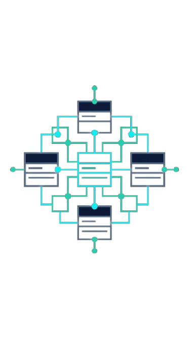
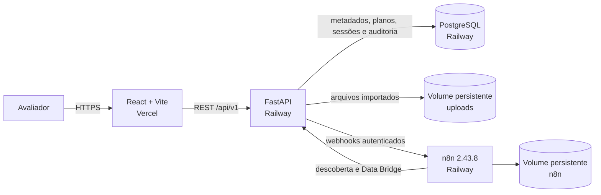
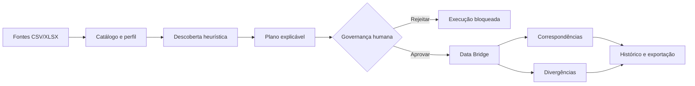

<p align="center">
  <a href="https://synapse-ai-six-puce.vercel.app" aria-label="Abrir o SYNAPSE AI">
    
  </a>
</p>

<h1 align="center">SYNAPSE AI</h1>

<p align="center">
  <strong>Sistemas que entendem sistemas.</strong><br>
  Descoberta explicável, governança humana e integração auditável de dados tabulares.
</p>

<p align="center">
  <a href="https://react.dev"></a>
  <a href="https://fastapi.tiangolo.com"></a>
  <a href="https://www.postgresql.org"></a>
  <a href="https://n8n.io"></a>
  <a href="./LICENSE"></a>
</p>

<p align="center">
  <a href="https://synapse-ai-six-puce.vercel.app"><strong>Aplicação online</strong></a>
  · <a href="./docs/README.md">Documentação</a>
  · <a href="./docs/DEPLOYMENT.md">Deploy</a>
  · <a href="./docs/SECURITY.md">Segurança</a>
  · <a href="./LICENSE">Licença</a>
</p>

> Projeto desenvolvido para o **Hackathon UNAMA 2026**. O ambiente publicado usa Vercel no frontend e serviços separados de FastAPI, PostgreSQL e n8n no Railway.

## Sumário

- [Visão geral](#visão-geral)
- [O problema](#o-problema)
- [O que está implementado](#o-que-está-implementado)
- [Arquitetura](#arquitetura)
- [Fluxo de dados](#fluxo-de-dados)
- [Como funciona a descoberta](#como-funciona-a-descoberta)
- [Segurança e autenticação](#segurança-e-autenticação)
- [Tecnologias e infraestrutura](#tecnologias-e-infraestrutura)
- [Capturas do produto](#capturas-do-produto)
- [Execução local](#execução-local)
- [Variáveis de ambiente](#variáveis-de-ambiente)
- [Testes e homologação](#testes-e-homologação)
- [Estrutura do repositório](#estrutura-do-repositório)
- [Limitações e evolução](#limitações-e-evolução)
- [Equipe](#equipe)
- [Licença](#licença)

## Visão geral

O SYNAPSE AI é um MVP de engenharia e governança de dados que transforma arquivos tabulares isolados em relações verificáveis. A plataforma cataloga fontes, examina seus esquemas e valores, propõe chaves candidatas com evidências, exige uma decisão humana e só então executa a reconciliação pelo Data Bridge.

O resultado é um fluxo reproduzível: cada proposta tem pontuação e justificativa; cada aprovação fica vinculada a um plano; cada execução registra resumo, correspondências e divergências.

## O problema

Equipes frequentemente recebem planilhas sem documentação, chaves padronizadas ou uma visão segura de como os dados se relacionam. A inspeção manual é lenta, difícil de repetir e pode levar uma hipótese diretamente à execução sem governança.

O SYNAPSE separa essas responsabilidades:

1. importa e descreve as fontes;
2. sugere relações de forma determinística e explicável;
3. submete o plano à avaliação humana;
4. bloqueia a execução até a aprovação;
5. reconcilia os dados e evidencia diferenças;
6. mantém histórico e permite exportar os resultados.

## O que está implementado

- importação de CSV, TSV, XLS e XLSX com validação de extensão e tamanho;
- catálogo de fontes com esquema, amostra, pesquisa, visualização e métricas de qualidade;
- renomeação, arquivamento, restauração e exclusão permanente com controles próprios;
- descoberta de relações candidatas por webhook n8n, com score, classificação, fatores e evidências;
- filtros para inspeção dos candidatos sem alterar a pontuação produzida pelo backend;
- planos de análise persistidos e governança humana obrigatória;
- Data Bridge para correspondências, registros exclusivos da origem e registros exclusivos do destino;
- histórico de execuções, visualização dos resultados e exportação em CSV e JSON;
- auditoria das operações administrativas;
- login real para avaliadores, além de autenticação técnica por API Key;
- interface responsiva React/Vite e ambiente de demonstração com dados sintéticos.

## Arquitetura



O navegador conversa somente com o FastAPI. Credenciais do PostgreSQL, chaves técnicas e autenticação dos webhooks permanecem nos serviços Railway e nunca são incorporadas ao bundle do frontend.

## Fluxo de dados



Na demonstração sintética, `cadastro_colaboradores.id_colaborador` é relacionado a `repasses_sinteticos.codigo_pessoa`. O resultado esperado é verificável: três correspondências, um registro apenas no cadastro e um apenas nos repasses.

## Como funciona a descoberta

A “inteligência” do SYNAPSE é um motor heurístico determinístico e explicável — não um modelo generativo treinado e não um LLM. Para cada par de colunas, o workflow considera sinais como:

- normalização de valores, incluindo espaços, caixa e zeros à esquerda;
- compatibilidade de tipos e nomes;
- interseção, sobreposição e similaridade entre conjuntos;
- unicidade e qualidade de cardinalidade;
- presença de nulos, repetições e risco de relação muitos-para-muitos.

Esses fatores compõem um score e uma classificação acompanhados de evidências concretas. A sugestão nunca aprova nem executa o plano de forma autônoma: a decisão pertence ao avaliador autorizado.

## Segurança e autenticação

Em staging e produção, `AUTH_REQUIRED=true` mantém as rotas operacionais protegidas. A Fase 8G adicionou autenticação individual para a banca com:

- senha verificada por hash Argon2id, sem persistir a senha em texto puro;
- sessão opaca com expiração, restauração após refresh e revogação no logout;
- persistência somente do hash SHA-256 do token de sessão;
- rate limiting de tentativas de login;
- papel `evaluator` autorizado a importar, descobrir, decidir governança, executar e consultar resultados;
- negação das rotas administrativas e destrutivas ao avaliador;
- compatibilidade preservada com as API Keys técnicas de operador e administrador.

Exclusões permanentes e manutenção administrativa possuem gates adicionais. Segredos ficam no Railway; nenhuma senha, hash, API Key, token de sessão, credencial do n8n ou URL de banco com credenciais deve ser publicada ou receber prefixo `VITE_`.

Consulte a [matriz de segurança](./docs/SECURITY.md) e o [guia de implantação](./docs/DEPLOYMENT.md) antes de alterar um ambiente publicado.

## Tecnologias e infraestrutura

| Camada | Tecnologia | Ambiente publicado |
|---|---|---|
| Frontend | React 19, TypeScript, Vite 8 e Tailwind CSS | Vercel |
| API | FastAPI, Pydantic e Uvicorn | Railway |
| Persistência | SQLAlchemy 2 e PostgreSQL | Railway PostgreSQL |
| Desenvolvimento local | SQLite | Arquivo local ignorado pelo Git |
| Orquestração | n8n `2.43.8`, com workflows versionados | Railway |
| Arquivos | Diretório configurável por `UPLOAD_DIR` | Volume persistente Railway |
| Qualidade | pytest, Playwright e oxlint | Local/CI |

O n8n e o backend usam imagens e configurações próprias para Railway. A porta HTTP é recebida dinamicamente do ambiente, e os arquivos e o estado do n8n ficam em volumes distintos.

## Capturas do produto

As capturas abaixo foram geradas pela aplicação real com estados sem dados pessoais ou institucionais.

### Descoberta explicável


### Governança e Data Bridge


### Gestão de fontes


## Execução local

### Pré-requisitos

- Node.js 20 ou superior e npm;
- Python 3.12 ou superior;
- n8n `2.43.8` para executar descoberta e Data Bridge.

### Frontend

```bash
npm install
cp .env.example .env.local
npm run dev
```

No PowerShell, use `Copy-Item .env.example .env.local`. O frontend ficará disponível em `http://localhost:5173`.

### Backend

```bash
python -m venv backend/.venv
source backend/.venv/bin/activate
python -m pip install -r backend/requirements-dev.txt
cp backend/.env.example backend/.env
uvicorn app.main:app --app-dir backend --host 0.0.0.0 --port 8000
```

No PowerShell:

```powershell
python -m venv backend/.venv
.\backend\.venv\Scripts\Activate.ps1
python -m pip install -r backend/requirements-dev.txt
Copy-Item backend/.env.example backend/.env
python -m uvicorn app.main:app --app-dir backend --host 0.0.0.0 --port 8000
```

A API ficará em `http://localhost:8000`, com health check em `http://localhost:8000/api/v1/health`.

### n8n

```bash
npx n8n@2.43.8 start
```

Importe e publique os workflows de `deploy/n8n/workflows/`. Os caminhos de desenvolvimento já estão documentados em `backend/.env.example`.

## Variáveis de ambiente

Use os arquivos `.env.example` como referência. Os exemplos abaixo são locais e não contêm valores de produção.

Frontend (`.env.local`):

```dotenv
VITE_API_URL=http://127.0.0.1:8000/api/v1
```

Backend (`backend/.env`):

```dotenv
ENVIRONMENT=development
DATABASE_URL=sqlite:///./synapse.db
UPLOAD_DIR=./uploads
BACKUP_DIR=./backups
CORS_ORIGINS=http://localhost:5173,http://127.0.0.1:5173
N8N_BASE_URL=http://localhost:5678
N8N_DISCOVERY_WEBHOOK_URL=http://localhost:5678/webhook/synapse-intelligent-discovery
N8N_DATA_BRIDGE_WEBHOOK_URL=http://localhost:5678/webhook/synapse-data-bridge
AUTH_REQUIRED=false
```

Para Railway/Vercel, configure apenas nomes suportados pelo código e armazene os valores sensíveis no gerenciador de segredos. Em particular:

| Serviço | Variáveis principais |
|---|---|
| Vercel | `VITE_API_URL` |
| FastAPI | `ENVIRONMENT`, `DATABASE_URL`, `CORS_ORIGINS`, `UPLOAD_DIR`, `BACKUP_DIR`, `AUTH_REQUIRED` |
| Integração n8n | `N8N_BASE_URL`, `N8N_DISCOVERY_WEBHOOK_URL`, `N8N_DATA_BRIDGE_WEBHOOK_URL`, `N8N_WEBHOOK_AUTH_HEADER`, `N8N_WEBHOOK_AUTH_VALUE` |
| Autenticação | `EVALUATOR_EMAIL`, `EVALUATOR_PASSWORD_HASH`, `EVALUATOR_SESSION_TTL_MINUTES`, `EVALUATOR_LOGIN_MAX_ATTEMPTS`, `EVALUATOR_LOGIN_WINDOW_SECONDS`, `OPERATOR_API_KEY`, `ADMIN_API_KEY` |

A matriz completa, incluindo PostgreSQL, volumes e n8n, está em [docs/DEPLOYMENT.md](./docs/DEPLOYMENT.md).

## Testes e homologação

```bash
python -m pytest backend/tests -q
npm run lint
npm run build
npm run test:e2e
```

Os testes backend cobrem autenticação, importação, gestão de fontes, descoberta, governança, execução, auditoria, segurança e compatibilidade PostgreSQL. O Playwright cobre login, sessão, logout, jornadas operacionais e responsividade.

No ambiente publicado, foram homologados:

- frontend Vercel acessível por HTTPS;
- health da API e conexão PostgreSQL;
- login válido e inválido, refresh de sessão e logout;
- bloqueio administrativo para o papel `evaluator`;
- importação dos arquivos sintéticos;
- Descoberta Inteligente e aprovação de governança;
- execução do Data Bridge no n8n;
- consulta dos resultados e exportações CSV/JSON;
- autenticação técnica preservada.

Testes integrados locais que acionam os webhooks exigem FastAPI e n8n ativos com os dois workflows publicados. Os relatórios de prontidão permanecem em [`docs/`](./docs/README.md).

## Estrutura do repositório

```text
synapse/
├── backend/
│   ├── app/                 # API, modelos, segurança e serviços
│   ├── tests/               # suíte pytest
│   ├── Dockerfile           # imagem FastAPI para Railway
│   └── railway.toml         # configuração do serviço FastAPI
├── demo_data/staging/       # duas fontes exclusivamente sintéticas
├── deploy/
│   ├── n8n/workflows/       # workflows publicados e versionados
│   └── railway/             # imagem, entrypoint e exemplos do n8n
├── docs/                    # arquitetura, segurança, deploy e relatórios
│   └── images/              # logo e capturas reais do produto
├── e2e/                     # jornadas Playwright
├── public/                  # ativos estáticos do frontend
├── src/                     # aplicação React/TypeScript
├── README.md
├── vercel.json
└── package.json
```

## Limitações e evolução

- a descoberta atual atende fontes tabulares e depende da representatividade dos registros analisados;
- o score é heurístico e deve ser interpretado como apoio à decisão, não como verdade automática;
- o ambiente de demonstração usa uma identidade de avaliador configurada por serviço, não um diretório multiusuário;
- banco e volume de uploads precisam ser copiados e restaurados de forma coordenada;
- os workflows do n8n precisam estar publicados e alcançáveis para descoberta e execução;
- a criação aditiva do esquema atende o MVP; uma evolução de longa duração deve adotar migrações versionadas;
- observabilidade ainda se concentra em health check, logs e trilhas persistidas.

Evoluções naturais incluem RBAC multiusuário, migrações formais, monitoramento centralizado, conectores adicionais e políticas mais amplas de qualidade — sem remover o gate humano de governança.

## Equipe

- **João Paulo Gomes — capitão**
- Victor Davi
- Lucas Gabriel
- Delcio Noronha
- Vitor Gabriel da Silva Magalhães

## Licença

Distribuído sob a [Licença MIT](./LICENSE). Copyright © 2026 João Paulo Gomes e colaboradores do SYNAPSE AI.
