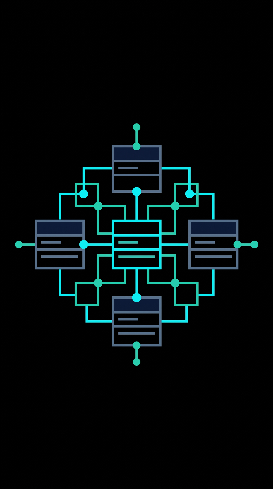
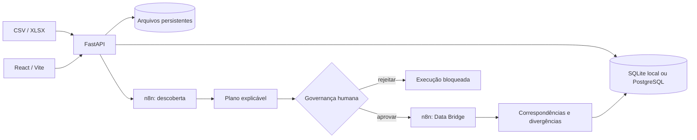
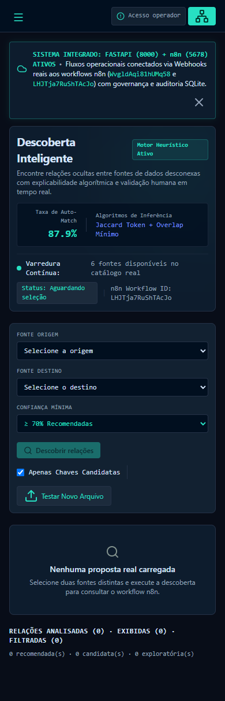
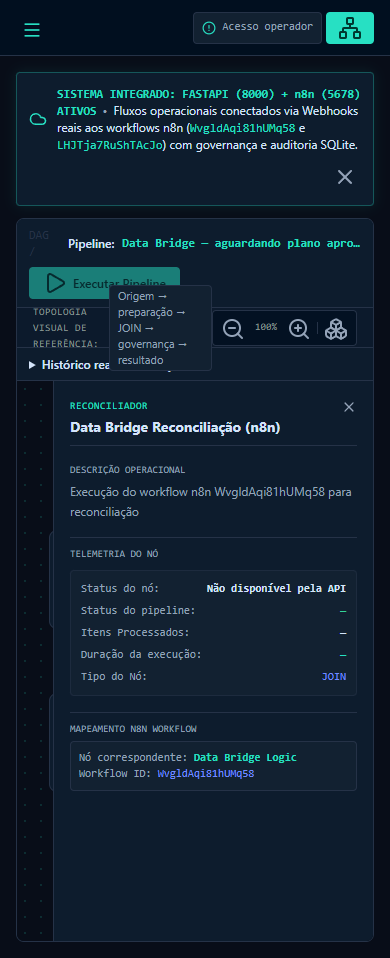
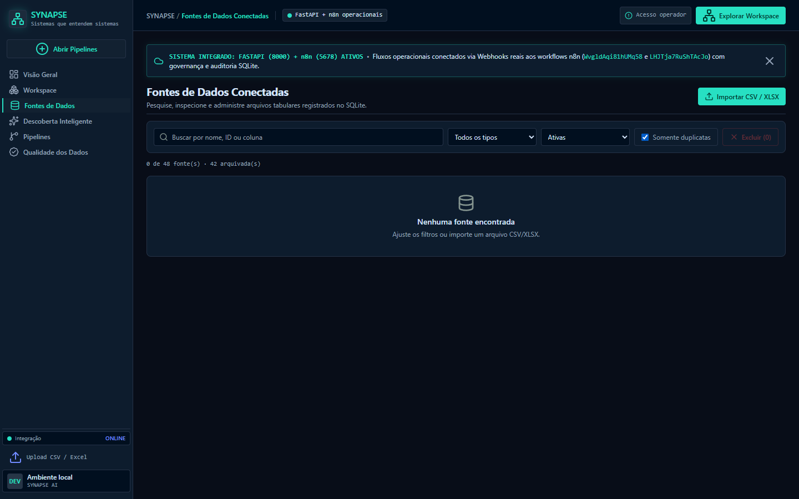

<p align="center">
  
</p>

# SYNAPSE AI

**Sistemas que entendem sistemas.** Um MVP de engenharia de dados para catalogar fontes tabulares, descobrir relações explicáveis, submeter propostas à governança humana e executar reconciliações auditáveis pelo n8n.

Projeto desenvolvido para o **Hackathon UNAMA 2026**, por **João Paulo Gomes**.

> Estado do projeto: funcional em ambiente local e preparado para staging. A publicação em Railway/Vercel ainda depende da configuração dos serviços e segredos descrita em [docs/DEPLOYMENT.md](./docs/DEPLOYMENT.md).

## O problema

Equipes recebem planilhas e bases isoladas sem conhecer, de antemão, quais colunas podem relacioná-las. A inspeção manual é lenta, difícil de reproduzir e frequentemente pula controles de aprovação. O SYNAPSE AI organiza esse fluxo: importa, cataloga, compara, explica, pede uma decisão humana e só então permite executar a integração.

## Para quem

- times de dados que precisam avaliar CSV/XLSX com rapidez;
- áreas de governança que exigem aprovação e trilha de auditoria;
- organizações que precisam demonstrar integrações sem usar dados pessoais ou institucionais reais.

## O que já funciona

- catálogo, visualização, arquivamento, restauração e exclusão controlada de fontes;
- importação de CSV, TSV, XLS e XLSX com limite e extensões configuráveis;
- persistência de metadados em SQLite local ou PostgreSQL por `DATABASE_URL`;
- descoberta de chaves candidatas via webhook n8n, com score, fatores e evidências;
- plano de análise com estados de governança e aprovação humana obrigatória;
- Data Bridge para JOIN, correspondências e divergências verificáveis;
- histórico de execuções e auditoria administrativa;
- autenticação Bearer separada para operador e administração;
- interface responsiva React/Vite, sem segredos embutidos no bundle;
- health check que valida a API e a conexão com o banco.

## Fluxo principal



A aplicação não treina nem hospeda um modelo generativo. A “descoberta inteligente” atual é um mecanismo heurístico determinístico e explicável, orquestrado pelo n8n. Detalhes: [visão técnica](./docs/TECHNICAL_OVERVIEW.md).

## Stack

| Camada | Tecnologia |
|---|---|
| Frontend | React 19, TypeScript, Vite 8, Tailwind CSS |
| API | FastAPI, Pydantic, SQLAlchemy 2 |
| Dados | SQLite no desenvolvimento; PostgreSQL preparado para staging |
| Orquestração | n8n `2.43.8`, com workflows versionados |
| Testes | pytest e Playwright |
| Publicação planejada | Vercel + Railway |

A identidade visual e seus tokens estão documentados em [DESIGN.md](./DESIGN.md) e `.stitch/`.

## Capturas do produto

As imagens abaixo vêm da aplicação real em execução. Foram selecionados estados sem dados pessoais ou institucionais.

### Descoberta explicável em tela móvel



### Pipeline e Data Bridge



### Gestão de fontes



## Estrutura do repositório

```text
backend/                 API, modelos, serviços e testes pytest
deploy/n8n/              imagem fixa, entrypoint e workflows do n8n
demo_data/staging/       dois arquivos exclusivamente sintéticos
docs/                    arquitetura, segurança, deploy e relatórios
e2e/                     testes Playwright
public/                  ativos estáticos
src/                     aplicação React/TypeScript
Dockerfile               imagem do FastAPI
railway.toml             configuração Railway do backend
vercel.json              configuração Vercel do frontend
```

## Execução local

### Pré-requisitos

- Node.js 20 ou superior e npm;
- Python 3.12 ou superior;
- uma instância n8n `2.43.8` para exercitar descoberta e Data Bridge.

### 1. Frontend

```bash
npm install
cp .env.example .env.local
npm run dev
```

No PowerShell, substitua o `cp` por `Copy-Item .env.example .env.local`.

### 2. Backend

```bash
python -m venv backend/.venv
source backend/.venv/bin/activate
python -m pip install -r backend/requirements.txt
cp backend/.env.example backend/.env
uvicorn app.main:app --app-dir backend --host 0.0.0.0 --port 8000
```

No PowerShell, ative com `backend/.venv/Scripts/Activate.ps1` e use `Copy-Item backend/.env.example backend/.env`.

### 3. n8n

```bash
npx n8n@2.43.8 start
```

Importe e publique os dois arquivos de `deploy/n8n/workflows/` e mantenha os caminhos de webhook iguais aos valores de `backend/.env.example`. O backend espera o n8n em `http://localhost:5678` no desenvolvimento.

Abra `http://localhost:5173`. A API estará em `http://localhost:8000`, com documentação em `/docs` e health check em `/api/v1/health`.

## Testes e verificações

```bash
python -m pip install -r backend/requirements-dev.txt
python -m pytest backend/tests -q
npm run lint
npm run build
npm run test:e2e
```

Os testes de integração que acionam descoberta e Data Bridge exigem FastAPI e n8n locais ativos com os workflows publicados. Os resultados auditados por fase estão em [docs/PHASE6_READINESS.md](./docs/PHASE6_READINESS.md) e [docs/PHASE8A_READINESS.md](./docs/PHASE8A_READINESS.md).

## Demonstração sintética

Use exclusivamente os arquivos de `demo_data/staging/`:

1. importe `cadastro_colaboradores.csv` e `repasses_sinteticos.csv`;
2. selecione as duas fontes na Descoberta Inteligente;
3. confira a relação `id_colaborador` ↔ `codigo_pessoa`;
4. aprove o plano como operador autorizado;
5. execute o pipeline e valide 3 correspondências, 1 registro apenas na origem e 1 apenas no destino.

Esses arquivos não derivam do SQLite nem dos uploads locais.

## Segurança e governança

Staging e produção devem usar `AUTH_REQUIRED=true`. Tokens são configurados apenas no backend/secret manager e nunca em variáveis `VITE_*`. Exclusões permanentes e manutenção administrativa têm controles adicionais. Consulte [docs/SECURITY.md](./docs/SECURITY.md) antes de publicar.

O repositório ignora `.env`, bancos locais, uploads, backups, logs, artefatos de teste e credenciais comuns. Mesmo assim, execute a auditoria do checklist antes de cada push.

## Documentação

- [Índice da documentação](./docs/README.md)
- [Visão técnica, modelo de dados e algoritmos](./docs/TECHNICAL_OVERVIEW.md)
- [Publicação Railway/Vercel, variáveis, backup e rollback](./docs/DEPLOYMENT.md)
- [Matriz de segurança da API](./docs/SECURITY.md)
- [Prontidão da Fase 8A](./docs/PHASE8A_READINESS.md)
- [Guia de contribuição](./CONTRIBUTING.md)

## Limitações conhecidas

- staging e produção ainda não foram provisionados nem homologados;
- a autenticação atual usa chaves Bearer compartilhadas, adequada ao MVP, mas não substitui identidade individual, rotação automatizada e RBAC;
- arquivos dependem de volume persistente no Railway; sem o volume, metadados podem apontar para conteúdo ausente;
- criação automática de esquema é suficiente para o MVP, mas evolução de produção deve adotar migrações versionadas;
- observabilidade ainda é baseada em logs, health check e auditoria no banco;
- a qualidade da descoberta depende da representatividade e normalização dos dados amostrados.

## Próximos passos

1. revisar a branch `deploy/staging-8a` como candidata à publicação;
2. provisionar PostgreSQL, FastAPI e n8n no Railway com volumes e secrets;
3. publicar o frontend na Vercel;
4. carregar somente a base sintética e executar a homologação ponta a ponta;
5. evoluir autenticação, migrações, monitoramento e testes de recuperação.

## Ferramentas e autoria

O produto foi concebido e implementado por **João Paulo Gomes**, com interface orientada pelo design system Stitch, automações n8n e assistência de ferramentas de desenvolvimento sob revisão humana. As regras de negócio, testes e decisões de governança permanecem versionados e auditáveis no repositório.

## Licença

Distribuído sob a licença MIT. Consulte [LICENSE](./LICENSE).
