# SYNAPSE AI — Sistemas que Entendem Sistemas
> **Plataforma de Descoberta Heurística, Integração Segura e Governança Mandatória de Dados**  
> *Projeto submetido ao Hackathon UNAMA 2026.2*

---

## 1. Visão Geral e Descrição

O **SYNAPSE AI** é uma plataforma corporativa projetada para resolver a fragmentação e a falta de rastreabilidade na integração de bases de dados heterogêneas. Em vez de depender de scripts pontuais frágeis ou de automações cegas que realizam junções de tabelas sem validação, o SYNAPSE AI combina **descoberta heurística de relacionamentos**, **orquestração de fluxos via n8n** e um **mecanismo mandatório de governança humana (Human-in-the-Loop)**.

Nenhum pipeline é executado sem que um operador humano qualificado revise as evidências concretas, os fatores de similaridade e registre formalmente a aprovação da chave de relacionamento.

---

## 2. O Problema Resolvido

Nas organizações públicas e privadas, bases de dados de RH, folha de pagamento, suprimentos e ERPs legados frequentemente utilizam identificadores discrepantes para se referir à mesma entidade:
* Base A (RH/Comercial): armazena o servidor sob a coluna `MATVINC`.
* Base B (Folha de Pagamentos em Excel): registra o pagamento sob `matricula_funcional`.

Integrar essas bases manualmente gera:
1. **Risco de Alucinação / Falso Positivo**: Algoritmos ingênuos tentam cruzar colunas por mera semelhança léxica (ex: `ANO_BASE` com `ANO_EXERCICIO`), gerando dados corrompidos.
2. **Ausência de Auditoria e Conformidade**: Junções feitas em planilhas ou queries avulsas não deixam rastros de quem autorizou o relacionamento ou qual foi a taxa de divergência.
3. **Falta de Conciliação em 3 Vias**: Dificuldade em identificar imediatamente quem está ativo sem receber pagamento e quem recebeu pagamento sem vínculo funcional cadastrado.

O SYNAPSE AI mitiga esses riscos isolando a descoberta, exigindo evidências matemáticas e bloqueando execuções não autorizadas.

---

## 3. Público-Alvo e Cenários de Aplicação

* **Auditorias Fiscais e Tribunais de Contas**: Cruzamento de folhas de pagamento contra cadastros de servidores para detecção de pagamentos indevidos ou "servidores fantasmas".
* **Controladoria e Compliance**: Conciliação de pedidos de compra contra notas fiscais e relatórios bancários em formatos legados (CSV e Excel).
* **Equipes de Engenharia de Dados e M&A**: Migração e unificação de sistemas legados durante fusões corporativas com documentação do racional de junção.

---

## 4. Funcionalidades Comprovadamente Implementadas

- [x] **Ingestão Universal e Parsing Estrito**: Upload com validação de formato para `.csv`, `.tsv`, `.xlsx` e `.xls`. Extração automática de metadados, contagem de registros, tipagem inferida (`integer`, `float`, `string`) e taxas de unicidade e valores nulos.
- [x] **Intelligent Discovery Heurístico (Workflow n8n `LHJTja7RuShTAcJo`)**: Avaliação determinística baseada em:
  - Similaridade semântica de nomes de campos via taxonomia;
  - Compatibilidade e coerência de tipos primitivos;
  - Sobreposição matemática de valores (`valoresEmComum` e índice Jaccard);
  - Penalização por duplicatas e dispersão nula.
  - Exibição de score heurístico (0 a 100%) e classificação de confiança (`CANDIDATO_RECOMENDADO`).
- [x] **Governança Estrita & Human-in-the-Loop**:
  - Bloqueio ativo de pipelines para planos pendentes ou rejeitados (HTTP 403 Forbidden).
  - Imunidade contra adulteração: o executor busca as chaves aprovadas diretamente do banco relacional, ignorando payloads adulterados pelo cliente.
  - Registro de justificativa formal e identificador do aprovador.
- [x] **Data Bridge & Reconciliação em 3 Vias (Workflow n8n `WvgldAqi81hUMq58`)**:
  - Identificação de **Registros Correspondentes** (ambas as bases coincidem).
  - Identificação de **Divergências Base A** (ex: funcionário sem pagamento correspondente).
  - Identificação de **Divergências Base B** (ex: pagamento lançado sem funcionário correspondente).
- [x] **Trilha de Auditoria Imutável**: Histórico com UUID, carimbo de data/hora, status, ID do workflow n8n executado e quantitativos auditados.
- [x] **Interface Moderna Stitch (Dark Mode)**: Sistema de design "Precision Orchestration" com tokens semânticos, paleta escura (#080D18 / #55fddf), acessibilidade e responsividade.
- [x] **Suíte com 12 Testes Automatizados**: Testes de ponta a ponta e casos de borda validando todas as regras de negócio e de governança.

---

## 5. Arquitetura e Stack Tecnológica

O SYNAPSE AI adota uma arquitetura em camadas desacopladas:

```
┌────────────────────────────────────────────────────────┐
│               Frontend (React 19 + Vite)              │
│       Google Stitch UI • Tailwind CSS • Lucide Icons   │
└───────────────────────────┬────────────────────────────┘
                            │ REST / JSON (Porta 5173 -> 8000)
┌───────────────────────────▼────────────────────────────┐
│              Backend (FastAPI • Python 3.13)            │
│  Validação Pydantic • SQLAlchemy 2.0 • SQLite Metadata │
│    Políticas de Governança Estrita & Trava de JOIN     │
└───────────────────────────┬────────────────────────────┘
                            │ Webhook HTTP POST (Porta 8000 -> 5678)
┌───────────────────────────▼────────────────────────────┐
│              Orquestrador n8n (v2.43.8)                │
│  - Intelligent Discovery Engine (LHJTja7RuShTAcJo)      │
│  - Data Bridge POC Reconciliador (WvgldAqi81hUMq58)     │
└────────────────────────────────────────────────────────┘
```

### Tecnologias:
* **Frontend**: React 19, TypeScript 5.8+, Vite 8, Tailwind CSS 3.4, Lucide React, React Router v7.
* **Backend**: FastAPI 0.115+, Uvicorn 0.30+, Pydantic v2, SQLAlchemy 2.0, HTTPX, OpenPyXL, Pandas, SQLite3.
* **Orquestrador de Dados**: n8n v2.43.8 (Community Edition / Local), JavaScript Task Runner.

---

## 6. Fluxo de Dados Completo

```mermaid
sequenceDiagram
    autonumber
    actor Operador as Auditor / Usuário
    participant UI as Frontend React
    participant API as FastAPI Backend
    participant DB as SQLite (Metadados)
    participant N8N as n8n Workflows

    Operador->>UI: Upload de funcionarios.csv e pagamentos.xlsx
    UI->>API: POST /api/v1/sources/upload
    API->>DB: Salva metadados e amostras
    API-->>UI: Retorna fontes cadastradas
    
    Operador->>UI: Solicita análise de descoberta entre as bases
    UI->>API: POST /api/v1/discovery/analyze
    API->>N8N: Dispara webhook do Intelligent Discovery
    N8N-->>API: Retorna Score (82%) e Evidências (1001, 1002 em comum)
    API->>DB: Registra AnalysisPlan (status: PENDING_APPROVAL)
    API-->>UI: Exibe proposta com evidências
    
    rect rgb(20, 30, 45)
    Note over Operador, API: Barreira de Governança (Human-in-the-Loop)
    Operador->>UI: Revisa fatores e clica em Aprovar
    UI->>API: POST /api/v1/governance/decide (approved=true, justificativa)
    API->>DB: Atualiza status do plano para APPROVED
    end

    Operador->>UI: Dispara execução do Pipeline
    UI->>API: POST /api/v1/pipelines/execute (plan_id)
    API->>DB: Valida se o plano está APPROVED
    API->>N8N: Dispara webhook do Data Bridge com dados e chaves seladas
    N8N-->>API: Retorna conciliação (Correspondentes, Divergentes A, Divergentes B)
    API->>DB: Grava PipelineExecutionModel e histórico de auditoria
    API-->>UI: Renderiza métricas e listagem reconciliada
```



---

## 7. Pré-requisitos de Instalação

* **Node.js**: versão 20.x ou superior e `npm`.
* **Python**: versão 3.11 ou superior (testado em Python 3.13).
* **n8n**: instalado globalmente via `npm install -g n8n` ou executável via `npx n8n`.
* **Git**: para clonagem e versionamento.

---

## 8. Configuração de Ambiente

1. Clone o repositório:
```bash
git clone <URL_DO_REPOSITORIO>
cd synapse
```

2. Instale as dependências do Frontend:
```bash
npm install
```

3. Configure o ambiente do Backend:
```bash
cd backend
python -m pip install -r requirements.txt
```

4. Crie o arquivo de variáveis de ambiente a partir do modelo (sem expor segredos):
```bash
cp .env.example .env
```
*O arquivo `.env` gerado utiliza portas padrões locais (`PORT=8000`, `N8N_BASE_URL=http://localhost:5678`), compatíveis com execução em sandbox local sem necessidade de credenciais de nuvem.*

---

## 9. Como Iniciar os Serviços

Para rodar o SYNAPSE AI por completo, execute os 3 componentes em terminais separados:

### Terminal 1 — Orquestrador n8n
```bash
npx n8n start
```
*Disponível em `http://localhost:5678`.*

### Terminal 2 — Backend FastAPI
```bash
cd backend
python -m uvicorn app.main:app --host 0.0.0.0 --port 8000 --reload
```
*Documentação Swagger disponível em `http://localhost:8000/docs`.*

### Terminal 3 — Frontend React
```bash
npm run dev
```
*Aplicação web acessível em `http://localhost:5173`.*

---

## 10. Como Executar os Testes Automatizados

Com o Backend e o n8n iniciados, execute no diretório raiz:

```bash
# Suíte de Integração Completa (9 testes)
python backend/tests/test_integrated_flow.py

# Suíte de Governança Estrita e Casos de Borda (3 testes)
python backend/tests/test_governance_edge_cases.py
```

**Resultado esperado:**
```text
Ran 12 tests in ~35s
OK
```

---

## 11. Reprodução da Demonstração com Dados Sintéticos

O projeto inclui um par de arquivos de teste para demonstração rápida em `backend/tests/fixtures/`:
* `funcionarios.csv`: Base de 3 servidores cadastrados (`1001` - Ana, `1002` - Bruno, `1003` - Carla).
* `pagamentos.xlsx`: Planilha de pagamentos (`1001` - R$ 2500, `1002` - R$ 3100, `1004` - R$ 2800).

### Passo a passo no navegador:
1. Abra `http://localhost:5173` no navegador.
2. Na página **Data Sources**, verifique o banner de integração (*Backend Conectado* e *n8n Online*).
3. Clique em **Importar Fonte** e faça o upload de `funcionarios.csv` e `pagamentos.xlsx`.
4. Acesse a aba **Intelligent Discovery** e clique em **Nova Análise**.
5. Observe o score calculado de **82%** recomendando a junção `MATVINC` ↔ `matricula_funcional` e verifique a lista de evidências apontando os valores comuns `1001` e `1002`.
6. Tente disparar o pipeline diretamente (comprovando o bloqueio de segurança).
7. Clique em **Aprovar Relação**, preenchendo a justificativa e o nome do auditor responsável.
8. Prossiga para a aba **Pipelines** e clique em **Executar Data Bridge**.
9. Visualize a reconciliação categorizada:
   - **Correspondentes**: 2 registros conciliados com sucesso.
   - **Sem Pagamento**: 1 servidora ativa sem folha lançada (Carla Dias - 1003).
   - **Pagamentos sem Funcionário**: 1 pagamento lançado sem cadastro no RH (1004).

---

## 12. Limitações Conhecidas e Roadmap Futuro

* **Autenticação de Webhook**: No MVP de demonstração local, os webhooks do n8n comunicam-se via HTTP local. Em produção exposta na nuvem, deve ser habilitada autenticação mútua via cabeçalho HMAC / Bearer Token.
* **Tamanho Máximo de Upload**: O limite atual está configurado em 10 MB por arquivo para garantir baixa latência na demonstração.
* **Integração com LLMs Corporativas**: O motor de descoberta do MVP opera em modo heurístico determinístico (taxonomia + overlap exato + Jaccard). O roadmap prevê integração com modelos de linguagem (ex: Gemini via Vertex AI) para anotação semântica de esquemas complexos com milhares de tabelas.
* **Exportação dos Resultados**: Exportação direta da lista de divergências auditadas para formatos PDF/A e Excel com assinatura digital.

---

## 13. Ferramentas de IA Utilizadas no Desenvolvimento

Em conformidade com as diretrizes de transparência e integridade acadêmica do Hackathon:
* **Google Stitch**: Utilizado para síntese e prototipagem inicial do Design System semanticamente documentado em `DESIGN.md`.
* **Antigravity IDE & Gemini 3.8 Flash**: Utilizados como assistente de codificação, revisão de código, automação de testes com Playwright e elaboração de fixtures sintéticas.
* **n8n Workflow Engine**: Nós de script e lógica em JavaScript para inferência determinística e reconciliação estruturada.

*Todas as regras de negócio, modelagens de governança, esquemas Pydantic, endpoints FastAPI e suítes de testes foram concebidos e implementados de forma verificável e determinística pela equipe.*

---

## 14. Licença

Este projeto é desenvolvido para fins de demonstração acadêmica e técnica no Hackathon UNAMA 2026.2.
* Licença de Software: MIT License (ver arquivo `LICENSE` ou a critério do mantenedor).
* Dados e Fixtures: Dados 100% sintéticos e de domínio público criados para a prova de conceito.
