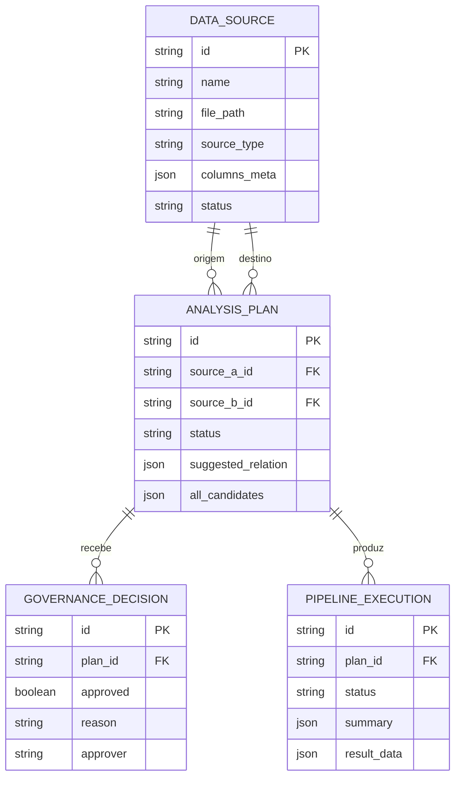

# Visão técnica do SYNAPSE AI

## Objetivo e escopo

O SYNAPSE AI é um MVP de catalogação e integração assistida de fontes tabulares. Ele identifica relações candidatas, apresenta evidências ao operador, exige uma decisão humana de governança e executa uma reconciliação auditável. Não é uma plataforma de ETL generalista nem um sistema de decisão autônoma.

## Componentes

| Componente | Responsabilidade |
|---|---|
| React/Vite | navegação, catálogo, descoberta, governança, pipelines e visualização dos resultados |
| FastAPI | contratos HTTP, autenticação, validação, persistência, arquivos e coordenação dos workflows |
| PostgreSQL/SQLite | fontes catalogadas, planos, decisões, execuções e auditoria administrativa |
| n8n | execução dos algoritmos de descoberta e do Data Bridge por webhooks |
| volume de arquivos | conteúdo original importado, referenciado pelo catálogo |

O frontend chama somente o FastAPI. O FastAPI acessa o banco e os arquivos e chama os webhooks do n8n. Em Railway, FastAPI e n8n podem usar URLs privadas; o navegador nunca deve receber credenciais ou URLs internas do n8n.

## Modelo de dados

`administrative_audit_events` registra operações administrativas separadamente. Os modelos usam tipos SQLAlchemy portáveis (`String`, `Integer`, `Float`, `Boolean`, `DateTime`, `Text`, `JSON` e chaves estrangeiras), e a suíte de prontidão compila todo o DDL com o dialeto PostgreSQL. A conexão real ainda precisa ser homologada no serviço provisionado.

## Importação e catálogo

O endpoint de upload valida extensão e tamanho antes de persistir. O nome físico recebe um UUID para evitar colisões e o diretório vem de `UPLOAD_DIR`. O registro no banco guarda metadados, amostras e o caminho do arquivo. Por isso, banco e volume precisam ser restaurados em conjunto.

Arquivamento é reversível. Exclusão permanente é uma ação distinta, protegida e bloqueada quando há dependências incompatíveis. A administração registra impacto e auditoria.

## Descoberta heurística

O FastAPI carrega as duas fontes selecionadas e envia seus registros ao workflow `intelligent-discovery.json`. O workflow compara pares de colunas com critérios determinísticos, incluindo normalização de valores, interseção e similaridade Jaccard, sobreposição mínima e sinais de compatibilidade. A resposta contém:

- par de colunas;
- score e classificação;
- fatores detalhados;
- evidências concretas;
- motivo de rejeição, quando aplicável.

O backend converte a resposta em candidatos com identificadores estáveis e persiste um `AnalysisPlan` em `PENDING_APPROVAL`. A heurística sugere; ela não aprova nem executa.

## Governança

Um operador autenticado pode aprovar ou rejeitar um plano pendente. A decisão fica vinculada ao plano, com justificativa, responsável lógico e data. O serviço recusa execução de plano pendente, rejeitado ou sem relação sugerida. Esse gate é aplicado no backend, não apenas na interface.

## Data Bridge

Após aprovação, o FastAPI envia ao workflow `data-bridge.json` os registros das duas fontes e as colunas aprovadas. O workflow normaliza as chaves, executa a reconciliação e devolve:

- registros correspondentes;
- registros apenas na origem;
- registros apenas no destino;
- contagens, duração e status.

O resultado e seu resumo ficam persistidos em `pipeline_executions`. A base sintética versionada permite verificar o contrato com 3 correspondências e duas divergências controladas.

## Segurança

Com `AUTH_REQUIRED=true`, uma dependência global protege todas as rotas `/api/v1`, exceto health e endpoints mínimos de autenticação. Operações administrativas exigem controles adicionais. Os webhooks n8n podem receber um cabeçalho secreto configurado somente no backend e no credential store do n8n.

Limitações e procedimento operacional estão em [SECURITY.md](./SECURITY.md); a matriz exata de variáveis e os passos de deploy estão em [DEPLOYMENT.md](./DEPLOYMENT.md).

## Testes

A suíte pytest cobre importação, gestão de fontes, descoberta, governança, execução, auditoria, segurança e prontidão PostgreSQL. O Playwright cobre jornadas e responsividade. Testes integrados de descoberta e Data Bridge requerem os dois workflows n8n publicados localmente.

## Decisões de implantação

- frontend estático na Vercel;
- FastAPI, PostgreSQL e n8n como serviços separados no Railway;
- versão do n8n fixada em `2.43.8`;
- volume próprio para `/data/uploads` no FastAPI;
- volume próprio para `/home/node/.n8n` no n8n;
- staging protegido e abastecido somente com dados sintéticos.

Essa topologia está preparada no repositório, mas ainda não foi provisionada nem homologada online.
